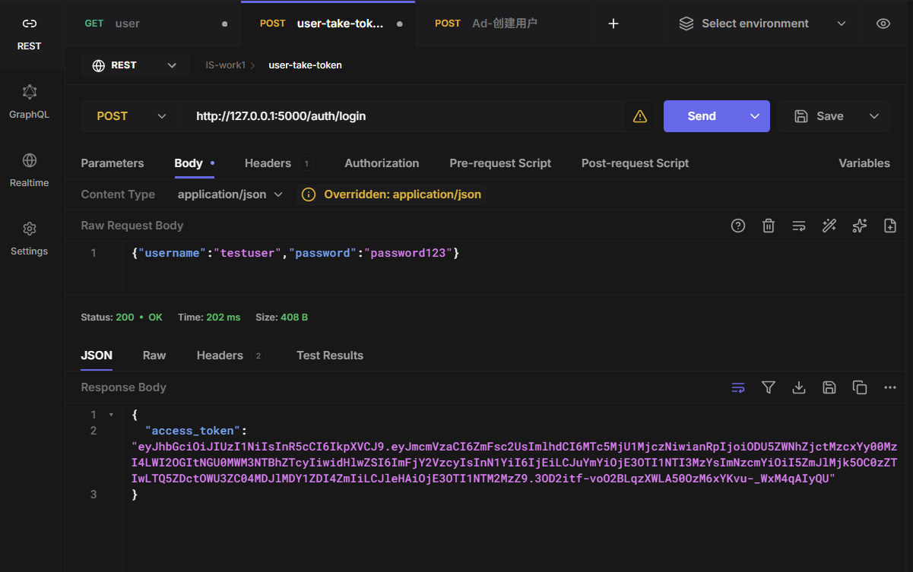
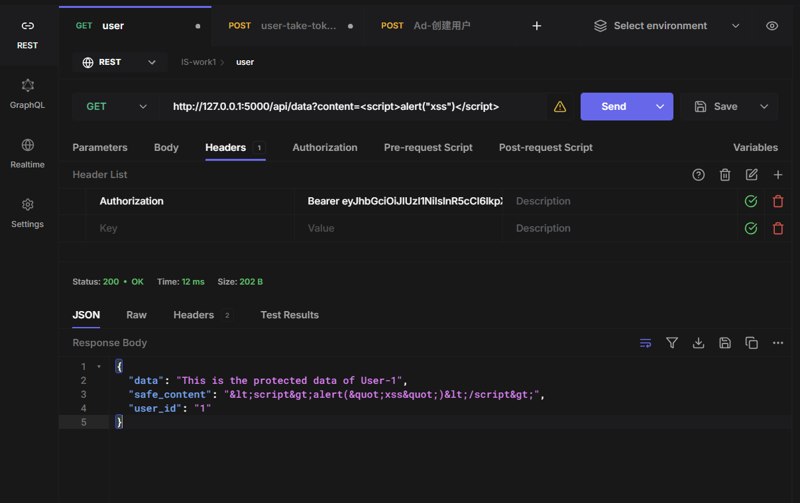
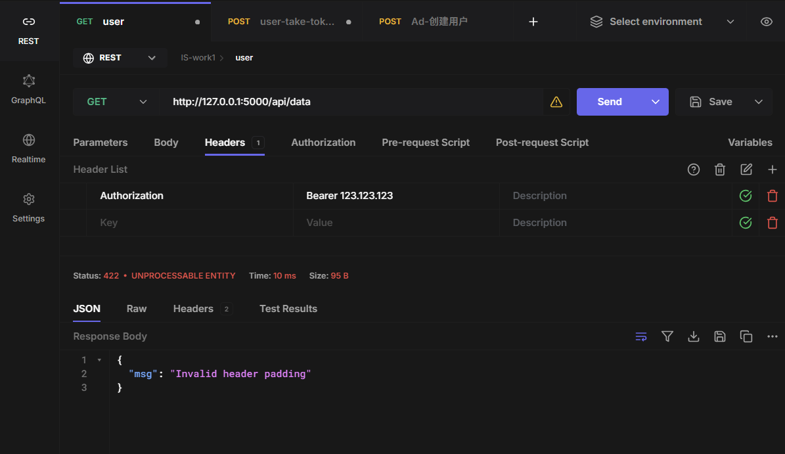
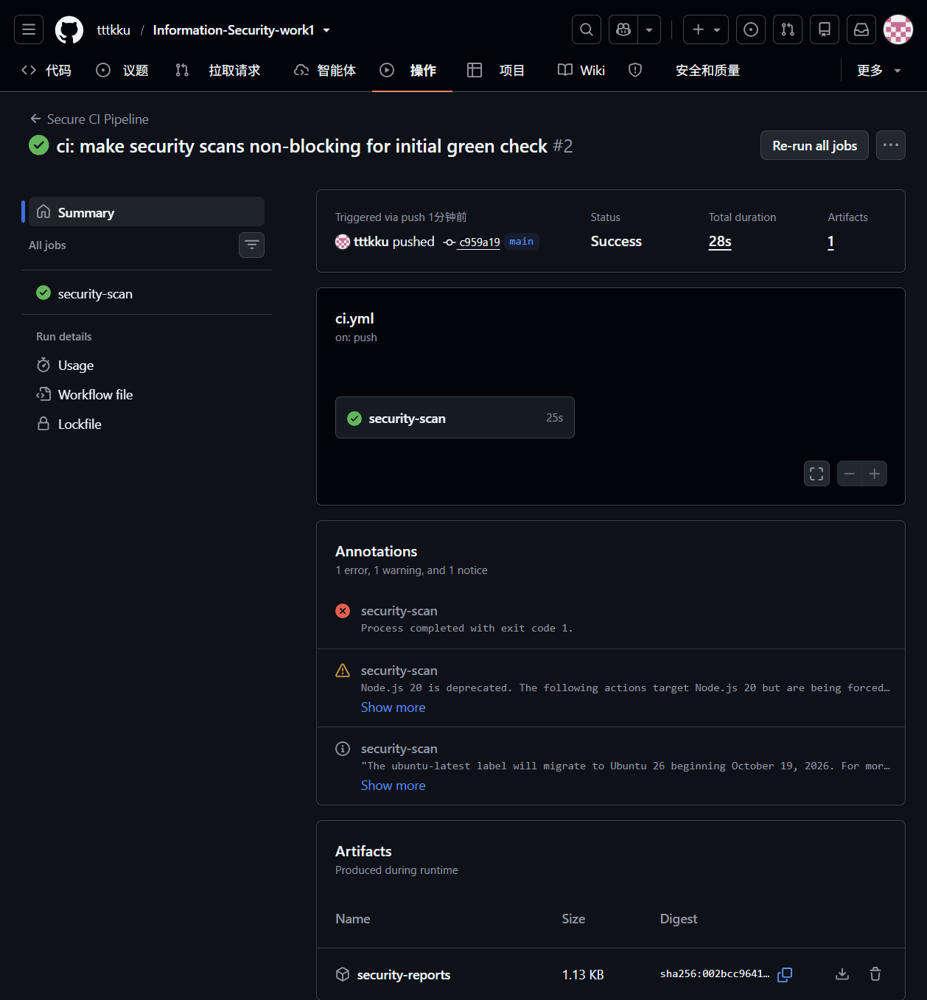
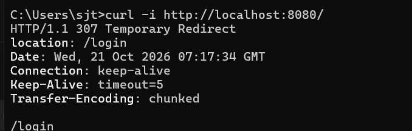
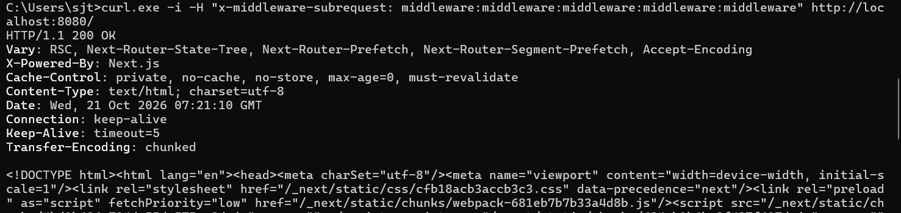
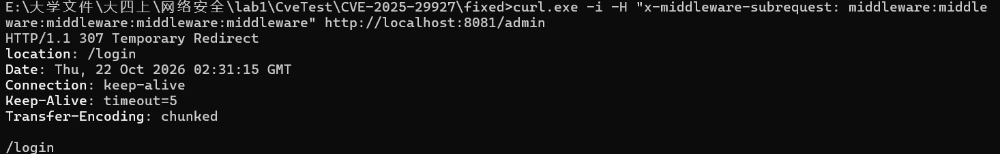

## Cover Info

* **Lab**: Work 1: Secure REST API Development with CI/CD and Real CVE Vulnerability Analysis1. Purpose of the Work

To gain practical experience in both building a secure backend application with automated vulnerability checking and analyzing/remediating a real-world vulnerability in a controlled environment.

## 2. Project & API Description

This project is built using Python (Flask) and SQLite. It provides 3 endpoints:

1. `POST /auth/login`: Authenticates users and returns a JWT token upon success.
   
2. `GET /api/data`: A protected endpoint that requires a valid JWT in the Authorization header.
   
3. `GET /api/health`: A public endpoint returning service status.

## 3. Implemented Security Measures

* **SQLi Protection**: Used SQLAlchemy ORM for database queries (`User.query.filter_by(username=username)`), which automatically uses parameterized queries to prevent SQL injection.
* **XSS Protection**: Used Python's built-in `html.escape()` function to sanitize user-controllable data before returning it in API responses. (As shown in screenshots, `<script>` is escaped to `&lt;script&gt;`).
* **Authentication**: Passwords are hashed using `Bcrypt` and stored securely. A JWT is issued upon successful login. Protected routes are secured using the `@jwt_required()` decorator, rejecting invalid tokens.
  

## 4. CI/CD Pipeline

Configured `.github/workflows/ci.yml` in GitHub Actions with two security tools:

* **SAST**: Used `Bandit` to scan the Python source code for security flaws.
* **SCA**: Used `pip-audit` to scan `requirements.txt` for known vulnerabilities in third-party dependencies.
  

## 5. CVE Reproduction

* **CVE ID**: CVE-2025-29927
* **Vulnerability**: Next.js Middleware Authorization Bypass.
* **Steps**: Normal access to `http://localhost:8080/` results in a `307 Temporary Redirect` to the login page.

  
* We used curl to send a malicious request with a forged header:

```bash
  curl -i -H "x-middleware-subrequest: middleware:middleware:middleware:middleware:middleware" http://localhost:8080/
```

  The attack was successful, bypassing the middleware and returning `200 OK` with the dashboard HTML source code 

## 6. Root Cause Analysis

The vulnerability is a logic error. Next.js uses the `x-middleware-subrequest` header internally to identify recursive sub-requests and prevent infinite middleware loops. However, it failed to filter this header from external requests. By forging this header, an attacker tricks the system into treating the request as a trusted internal sub-request, causing the middleware to skip the authentication logic entirely.

## 7. Applied Fix & Verification

* **Fix**: Stopped the containers and modified `docker-compose.yml` to update the Next.js image version from the vulnerable version to the patched version (e.g., `15.2.3` or higher). Rebuilt and restarted the environment.
* **Verification**: Repeated the same curl attack with the forged header. The patched application correctly rejected the malicious request, returning `307 Temporary Redirect` instead of `200 OK`, proving the vulnerability has been eliminated and normal functionality is maintained.

  
